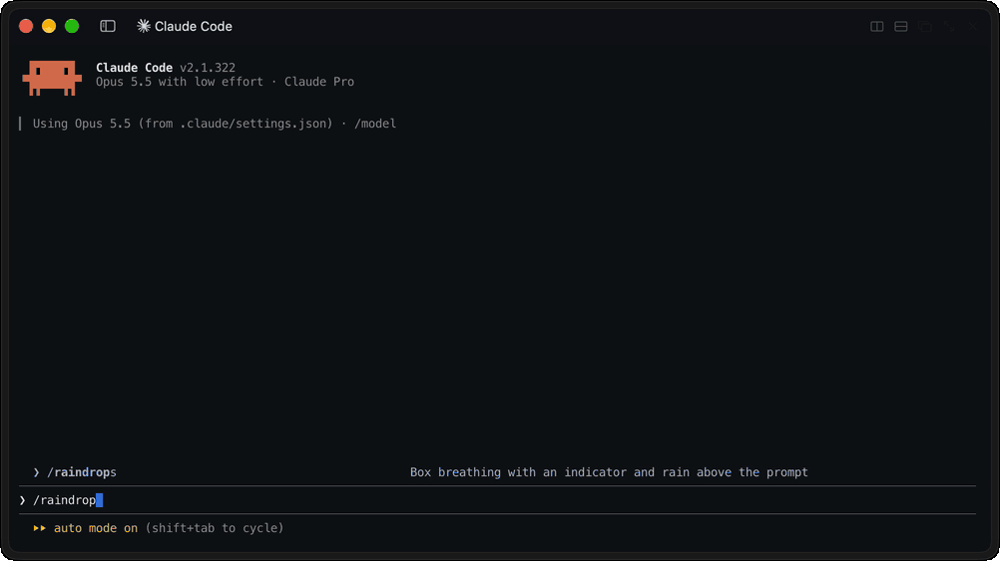

# raindrops [](https://github.com/hastefuI/raindrops/actions/workflows/ci.yml) [](https://github.com/hastefuI/raindrops/blob/main/LICENSE)

Raindrops is a native Claude Code mod that brings [box breathing](https://www.dvidshub.net/news/346467/breathing-relaxation) to the terminal.



```text
⛆ raindrops ████░░░░ 1/4 inhale 3s
```

## Install

```sh
claude plugin install raindrops --marketplace https://hasteful.ai/marketplace.json --scope user
```

Start Claude Code and then run `/raindrops`.

## Removal

```sh
claude plugin uninstall raindrops@hasteful --scope user
```

## License

Licensed under the [MIT License](https://opensource.org/licenses/MIT). See [LICENSE](./LICENSE) for details.

Copyright (c) 2026-present hasteful
